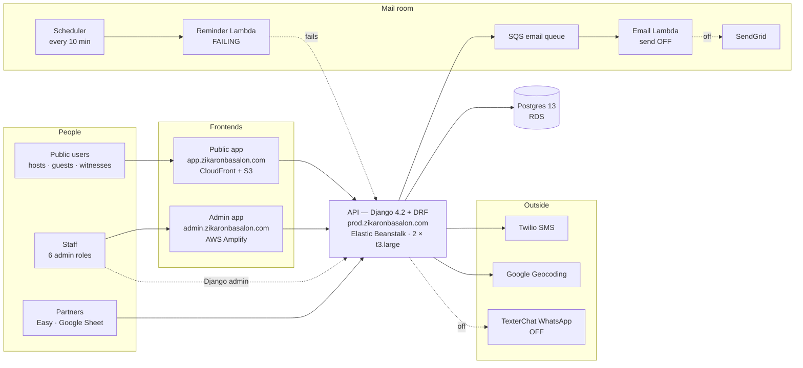

# Zikaron BaSalon — System Architecture

> Customer: zikaron-basalon · Written: 2026-11-22 · Scope: the **live legacy system** (the rewrite target is in [ecosystem.md](ecosystem.md))
> Sources: the three repos, the AWS account (two read-only passes, 2026-11-22), public DNS and the public JS bundles.
> Companion docs: [architecture-map.md](architecture-map.md) (every connection, numbered) · [topology.md](topology.md) (one API, two frontends: barriers) · [infrastructure-and-runtime.md](../products/platform/legacy-baseline/infrastructure-and-runtime.md) (deep runtime and AWS detail) · [design-reference.md](design-reference.md) (the prototype).
> No AWS account IDs, IP addresses or AWS-generated hostnames appear here.

## Contents

1. [The system in one page](#1-the-system-in-one-page)
2. [Repositories](#2-repositories)
3. [Backend — zikaron-basalon-be](#3-backend--zikaron-basalon-be)
4. [Public app — zikaron-basalon-fe](#4-public-app--zikaron-basalon-fe)
5. [Admin app — zikaron-basalon-fe-admin](#5-admin-app--zikaron-basalon-fe-admin)
6. [Infrastructure](#6-infrastructure)
7. [Delivery: how code reaches production](#7-delivery-how-code-reaches-production)
8. [Environments](#8-environments)
9. [End-to-end flows](#9-end-to-end-flows)
10. [Risks to know before touching anything](#10-risks-to-know-before-touching-anything)
11. [Open questions](#11-open-questions)

## 1. The system in one page

Zikaron BaSalon runs one season a year: **hosts** open their living rooms for a salon on a salon day, **guests** find a salon on a map and register, **staff** match ("team") a **witness** to each salon, and the host sees who is coming. Activity peaks in the weeks before Yom HaShoah.

The software is **one Django API with two React apps in front of it**, plus a small mail room of AWS queues and Lambdas:



Key facts:

- **Both apps call the same API** with the same kind of JWT. The API is the only thing that touches the database and the outside world.
- **The API does its outside calls inside the user's request** (and inside the database transaction): database, Twilio, Google Geocoding, WhatsApp, the email queue.
- **Capacity:** gunicorn with 3 sync workers on each of 2 servers, so 6 requests at once. Autoscaling never fires.
- **Notifications are off for the off-season, on purpose:** the email Lambda's send line is commented out, the reminder Lambda fails on every run, and WhatsApp is disabled. SMS login codes still work.
- **Everything runs in AWS `eu-west-3` (Paris).** DNS is at Wix. A separate system, Salon Builder, shares the AWS account in us-east-1 and is out of scope.

## 2. Repositories

| Repo | What it is | Stack | Hosted on | Deployed by | Default branches |
|---|---|---|---|---|---|
| `zikaron-basalon-be` | The API and Django admin | Python 3.12, Django 4.2, DRF 3.14, Postgres | Elastic Beanstalk | CodePipeline → CodeBuild → EB | `main` (prod), `dev` |
| `zikaron-basalon-fe` | Public app (hosts, guests, witnesses), plus an old admin copy | React 16 CRA, TypeScript, MUI 4, redux-saga | S3 + CloudFront | CodePipeline → CodeBuild → S3 | `main` (prod), `dev` |
| `zikaron-basalon-fe-admin` | Staff app | React 16 CRA, TypeScript, MUI 4, redux-saga | AWS Amplify | Amplify auto-build | `main` (prod), `development` |
| *(none)* | Email Lambda, two reminder Lambdas, cache-invalidation Lambda | Python 3.10 | Lambda | edited by hand in the console | — |
| `prototype/zikaron-next` (in this hub) | Clickable prototype of the redesign, demo data only | Next.js 15, React 19, Tailwind v4 | not deployed | — | — |

All three repos are private in the `MoveoTech` GitHub org. None has release tags, and no pipeline runs tests. The `staging` branches are 161–432 commits behind `main`.

## 3. Backend — zikaron-basalon-be

`zikaron-basalon-be` is the single Django 4.2 + Django REST Framework project behind both frontends.

- **Domain apps:** five Django apps split by actor: `users`, `hosts`, `guests`, `witnesses`, and `salon` (the witness↔salon assignment plus reference data).
- **Shared package:** `common` holds permissions, pagination, email, WhatsApp and admin helpers.
- **Project package:** `zikaronBasalon/` mounts every app's router under `/api/`, Django admin at `/admin/`, and Swagger at `/swagger/`.
- **How the code is organized:** each app follows the same layout (`models.py`, `views.py`, a serializer module, `filter_backends.py`, `signals.py`, `admin.py`, `urls.py`, `management/commands/`).
- **Where the business logic lives:** in signal receivers, not in views or services.

### Folder tree

```
zikaron-basalon-be/
├── manage.py                 Django entry point
├── middleware.py             HealthCheckMiddleware: answers GET /health with "ok"
├── zikaronBasalon/           project package: settings.py, urls.py, wsgi.py
├── users/                    custom User, login/SMS/password reset, EventBridge reminder endpoint
├── hosts/                    Host, HostSalon (a salon event), trainings, comments, content; map, teaming, dashboards, Easy feed
├── guests/                   Guest, GuestSalon (a registration); salon-guests, dashboard
├── witnesses/                Witness CRM, availability (WitnessSalon), comments; teaming, CSV, Google Sheet webhook
├── salon/                    Salon (witness↔salon assignment), SalonDay, City, Country, Community, Language
├── common/                   permissions + role matrix, pagination, emails (SQS), WhatsApp (TexterChat), templates model
├── templates/
│   ├── emails/               Hebrew email HTML per event code + english/ + base_email.html
│   │   └── create-new-salon-old-Implementation/   leftover old templates
│   └── admin/                custom Django-admin change lists and confirm pages
├── notification_events.ts    TypeScript registry of notification event codes (documentation; nothing imports it)
├── email-lambda-sqs/         copy of the SQS → SendGrid Lambda (differs from the deployed one; deployed by hand)
├── docs/                     eventbridge-reminders.md (partly outdated)
├── requirements.txt          pinned Python deps (several unused: gevent, eventlet, redis, whitenoise…)
├── Procfile                  gunicorn, 3 sync workers, :8080 (used by Elastic Beanstalk)
├── .ebextensions/            EB config: packages, WSGI path, leader-only cron, custom scaling alarms
├── .platform/hooks/          postdeploy: migrate + collectstatic on the leader
├── .elasticbeanstalk/        EB CLI local config
├── buildspec.yml             CodeBuild: pip install, echoes "Running tests" (runs none)
├── buildspec-server.yml      CodeBuild used by CodePipeline: pip install, ships whole repo
├── buildspec-client.yml      DEAD: Nx frontend template, no package.json here
├── infrastructure-live/      DEAD/STALE: Terragrunt from Dec 2022 (develop only, Python 3.8)
├── runtime.txt               DEAD: Heroku leftover, ignored by EB
├── latest.dump               a production database dump tracked in git (ships in every deploy)
├── .github/                  security-scans.yml (gitleaks, TruffleHog), dependabot.yml
├── agent-os/                 official AgentOS specs + standards (not migrated)
└── .claude/, .cursor/, CLAUDE.md   AI tooling notes and plans
```

### Project package `zikaronBasalon/`

- **`settings.py`.** There is one settings module for every environment, reading env vars through `python-decouple`.
  - **Installed apps:** DRF, simplejwt, dj-rest-auth (+ registration), allauth (Google; Facebook is still installed), django-oauth-toolkit, social-django and drf-social-oauth2 (Google convert-token), drf-yasg, corsheaders, phonenumber_field, multiselectfield, import_export, django-rest-passwordreset, and the six local apps.
  - **Request and auth defaults:**
    - DRF: `IsAuthenticated` by default, no default pagination or throttling.
    - Every request is one DB transaction (`ATOMIC_REQUESTS=True`).
    - `CONN_MAX_AGE=0`.
    - `LocMemCache`.
  - **Time:** `TIME_ZONE='Asia/Jerusalem'` with `USE_TZ=False`.
  - **Open by default:** CORS allows all origins, `ALLOWED_HOSTS=['*']`, and `DEBUG` is read without `cast=bool`.
  - **Compatibility shims:** the top of the file monkey-patches Django 2-era APIs (`ugettext`, `conf.urls.url`, `Signal(providing_args)`, multiselect `max_length`) so old libraries keep importing.
- **`urls.py`.**
  - `path('admin/', admin.site.urls)`.
  - `path('api/', include(...))` for `salon`, `witnesses`, `hosts`, `guests` and `users`, in that order.
  - `swagger/` (public).
  - `staticfiles_urlpatterns()`.
  - Each app's `urls.py` registers DRF `SimpleRouter` viewsets plus a few plain `path()`s, so every API URL is `/api/<prefix>/…`, unversioned.
- **`wsgi.py`.** The standard WSGI app, which the Procfile runs under gunicorn. There is no ASGI.
- **`middleware.py`** (repo root). `HealthCheckMiddleware`, registered last in `MIDDLEWARE`.

### Apps

#### `users` — identity and auth

| | |
|---|---|
| Models | `User` (AbstractUser; login by unique `email`; `role` = one of 9 strings: 6 admin roles + host, guest, witness; `communities` M2M→Community; `primary_language`; flags `should_ask_to_convert`, `igul_le_tova`, `confirm_policy`; `phone`). `EmailStatus` (1:1 User; reminder "already sent" flags). `Passcode` (FK User; 4-digit SMS `code`, `created_at`). |
| Routes | `auth/login/` (`CustomLoginView`, issues a 365-day refresh token to admin roles via `tokens.py`), `auth/…` (dj-rest-auth: logout, user, password change, token refresh), `auth/convert-token` (drf-social-oauth2, Google), `accounts/` (allauth), `auth/registration/`, `auth/verify_token/`, `password_reset/` and `password_reset/confirm/` (`password_reset_views.py`, social-aware). Routers: `user_data` (`UserProfileView`: profile get/update, `convert_user_selected`, `igul_le_tova`, `mark_igul_le_tova`), `sms_authentication` (`PhoneAutenticationView`: `auth`, `auth_with_code`, `change_password`; AllowAny), `eventbridge_tasks` (`EventBridgeView.eventbridge_send_reminders`, `HasAPIKeyPermission`). |
| Other modules | `adapter.py` (allauth account adapter), `serializers.py`, `token_serializers.py`, `tokens.py` (`CustomRefreshToken`). |
| Signals | `pre_save User` (normalisation); `post_save User` creates `EmailStatus` and, for guests, a `Guest` row; `reset_password_token_created` sends the reset email. |
| Admin | `UserAdmin` with bulk actions and custom URLs (`ask_to_convert.html`) that start **background threads** for `should_ask_to_convert` and `igul_le_tova`; `EmailStatusAdmin` with a thread for the email-status job; "safe" read-only admins for allauth/simplejwt/password-reset/social tokens. |
| Commands | ~30 in `management/commands/`. Season jobs: `should_ask_to_convert`, `igul_le_tova`, `email_status`, `useremailstatus`, `open_all_dates_in_year`, `witness_availability`, `reset_host_salon_guests`, `check_double_teaming`, `once_a_hour_task` (the cron job; all sends commented out). The rest are one-off migrations and fixtures (`*migration`, `fakedataloading`, `deletefakedata`, `corona`, `temp`, `idan_update_…`). |
| Tests | `users/tests.py` is empty. |

#### `hosts` — hosts and salon events

| | |
|---|---|
| Models | `Host` (1:1 User; `is_org`, `org_name`, `org_type` from 17 choices in `choices.py`, `phone`). `HostSalonTraining` (`event_time`, address, FK City). `HostSalon` (FK Host; one salon event: `event_time`, FK Language, FK City, address, `lat`/`lng`, `accessibility` multiselect, `survivor_needed`, `is_open_for_guests`, `is_digital`, capacity and stored counters `invites_pending_count`/`invites_confirmed_count`, staff flags `contacted`, `preparation_evening`, `special_attention`, `special_population`, FK `volunteer`→User, FK `host_salon_training`). `HostSalonComments` (staff notes). `HostSalonContent` (customized-salon content blocks: `headline`, `description`, `type`). |
| Routes | `hosts` (`HostView`), `host_salons` (`HostSalonView`; actions `relevant_witnesses`, `check_time_range`), `host_salons/<id>/comments`, `host_salons_list` (admin table), `host_salons_teaming` (`HostsSalonsTeamingView`), `host_salons_map` (`HostSalonMapView`, public read, LocMem-cached), `host_salons_dashboard`, `hosts_dashboard`, `host_salon_training`, `host_salon_content`, `host_salons_for_easy_integration` (Easy partner feed, Basic auth via `IsAccessAllowsEasySalonList`). |
| Serializers | `hosts/serializer.py` (~1,050 lines): separate serializers per audience (map vs admin vs host), the edit rules for date/time locks and capacity with error codes 1001/1002/1003, and map serialisation that strips host contact details for non-admins. |
| Filters | `filter_backends.py`: `HostsFilter`, `HostsSalonsFilter`, `HostsSalonsListFilter`, `HostsSalonsMapFilter` (city/date/time-of-day), `HostsSalonsTeamingFilter`, `HostSalonContentFilter`. **Role/community scoping happens here and in `get_queryset`.** |
| Signals | `Host` post_save: volunteer email. `HostSalon` pre/post_save: registration emails and WhatsApp (4 variants: with or without a prior registration, digital or not, via `NotificationService`), and auto-creating a `Salon` when no witness is needed. |
| Admin | `HostAdmin`/`HostSalonAdmin` with django-import-export; training and content admins with bulk actions. |
| Commands / tests | `create_fake_hosts`. Tests in `hosts/tests/tests.py` cover dashboards only. |

#### `guests` — guests and registrations

| | |
|---|---|
| Models | `Guest` (1:1 User; `phone`, FK City, address, `lat`/`lng`, `received_register_reminder_email`). `GuestSalon` (**1:1 Guest**, so one registration per guest; FK HostSalon; `status` default `approved`; `guests_number` 1–3; `host_received_approve_request_email`). |
| Routes | `guests` (`GuestView`), `salonguests` (`SalonGuestsView`: create/update/delete registrations, `IsAccessAllowsGuestSalon`), `guests_dashboard`. |
| Serializers | `guests/serializer.py`: registration validation. Capacity and openness checks live here, and so does the deletion of a guest's previous registration when they join a new salon. |
| Signals | `GuestSalon` post_save: `guests_1` email + WhatsApp, host emails (`hosts_5`), and status changes (`guests_2/3/4`). `post_delete GuestSalon`: `hosts_4` email to the host. Counters and `is_open_for_guests` are recomputed here. |
| Admin | `GuestAdmin`, `GuestSalonAdmin` with CSV/Excel export actions. |
| Commands / tests | `create_fake_guests`; `guests/tests/tests.py` (dashboards). |

#### `witnesses` — witness CRM and availability

| | |
|---|---|
| Models | `Witness` (optional 1:1 User; M2M Language; FK City; names, contact details, `witness_type`, `stairs`/`accessibility_need`, `special_population` multiselect, `availability_status`, **`available_for_teaming`** (derived), archive fields, contact person, FK `volunteer`, `can_use_zoom`, `take_part_in_additional_programs`, `witness_presentation_details`). `WitnessSalon` (FK Witness; one availability slot: `salon_date` + `can_morning`/`can_afternoon`/`can_evening`). `WitnessYearComment`, `WitnessComments`. |
| Routes | `witnesses` (`WitnessView`; actions `details_for_host`, `relevant_host_salons`, and others), `witnesses_teaming`, `witnesses/<id>/witnesses_availability_salons` (`WitnessSalonView`, bulk POST), `witnesses/<id>/witness_year_comments`, `witnesses/<id>/witness_comments` (**permission line commented out**), `witnesses_duplicate_validation`, `witnesses_dashboard`. Plain paths: `export_witnesses` (super admin CSV), `import_witnesses_presentation_details/` (super admin CSV), `google_sheet_webhook/` (AllowAny + encrypted token, `decrypt_token` in `common/utils.py`). |
| Other | Geocoding for witness addresses is called inline from `views.py` (`GOOGLE_API_KEY`). `choices.py` holds the statuses and types. |
| Signals | `Witness` post_save: recomputes `available_for_teaming`; leaving "available" deletes future slots (the only `transaction.on_commit` in the codebase). `WitnessSalon` post_save/post_delete: keep `available_for_teaming` in sync. |
| Admin | `WitnessAdmin` (import-export; custom URLs starting **threads** for `archive_witnesses`) and `WitnessSalonAdmin` (thread for `global_availability_all`). |
| Commands / tests | `archive_witnesses`, `global_availability_all`, plus one-off migrations; `witnesses/tests/tests.py` (dashboards). |

#### `salon` — assignments and reference data

| | |
|---|---|
| Models | `Salon` (**the assignment**: 1:1 `host_salon`, 1:1 `witness_salon` (a WitnessSalon slot), `assignment_time`, `host_contacted_witness`, `assigned_by`). `SalonDay` (`date` unique, `default_for_year`, `day_type`). `Country` (PK `country_code`), `Community`, `City` (FK Country, FK Community, `google_id`), `Language`. |
| Routes | `salons` (`SalonsView`: assign/replace/unassign through POST/PATCH/DELETE), `salondays` (+ `default-day/<year>`), `cities`, `languages`, `communities`, plain path `export_communities` (unauthenticated). |
| Signals | `Salon` post_save: host emails `hosts_2a`–`2e` chosen by witness type (a mapping table in `signals.py`), WhatsApp, and `cancel_witness` on replace. `post_delete Salon`: unassign effects (deleting a `Salon` also cascades to its `HostSalon`). |
| Admin | `SalonAdmin` (actions), `CityAdmin`, `CommunityAdmin` (export change list), `SalonDayAdmin`. |
| Other / tests | `utils.py` (time-slot helpers); `salon/tests.py` is broken. |

#### `common` — shared plumbing

- **`utils.py`:** the `UserRules` enum, the **`user_permissions` role matrix**, the permission classes (`IsUserAccessAllows`, `IsAccessAllowsHostSalon`, `IsAccessAllowsGuestSalon`, `IsAccessAllowsSalon`, `IsAccessAllowsEasySalonList`, `IsSuperAdmin`, `HasAPIKeyPermission`), `PostPagePagination`/`RelevantPagination` (15 per page), time-of-day constants, CSV/Excel admin export actions, `random_code`, `is_time_compatible`, `decrypt_token`.
- **`emails.py`** (~1,700 lines):
  - `send_to_sqs()`.
  - `EmailSending`, with ~65 `send_email_<event>` methods that render a file template, plus `send_email_from_db`, which renders an `EmailMessageTemplate` inside `base_email.html`.
- **`notifications.py`:** `NotificationService.send_notification()`. It calls the given email method, then optionally sends WhatsApp through `texterchat_client.py` (gated by `WHATSAPP_ENABLED`).
- **`models.py`:** `EmailMessageTemplate` (`event_code`, `language`, `subject`, `content`, `is_active`), seeded by `populate_email_templates`.
- **Other modules:**
  - `admin_recources.py`: import-export resources.
  - `admin_filters.py`.
  - `fields.py`: `BooleanListField`.
  - `logger.py`.
  - `common_functions.py`.
  - `WHATSAPP_INTEGRATION.md`.

### Cross-cutting

**How a request flows through the code**

1. `zikaronBasalon/urls.py` → app router → viewset.
2. Authentication: JWT, OAuth2, session or social.
3. A permission class from `common/utils.py`:
   - It looks up `user_permissions[view.basename]` and checks that `request.user.role` is in that tuple.
   - Some classes add per-method rules (`IsAccessAllowsHostSalon` uses the `hosts` and `hosts_salons_list` entries).
   - **A basename missing from the matrix is allowed for any authenticated user.**
4. `get_queryset` / `get_serializer_class` branch on role and community (super admin sees everything; other admin roles see their communities; a host sees their own data).
5. The filter backend applies the query-string filters.
6. The serializer validates; this is where the capacity and time-lock rules live.
7. `save()` inside the request transaction (`ATOMIC_REQUESTS`).
8. **Signals fire synchronously:**
   - counters and flags are updated;
   - `EmailSending.send_email_*` calls `send_to_sqs`, which sends to the SQS queue;
   - `NotificationService` calls TexterChat;
   - all of it inside the same transaction.

**Notifications.** Email templates come from two places:
- files under `templates/emails/<event>.html` and `templates/emails/english/`;
- DB templates (`EmailMessageTemplate`) rendered into `base_email.html`.

Event codes follow `hosts_*`, `guests_*`, `volunteer_*` and `cancel_witness`. `notification_events.ts` documents them.

**Pagination.** `PostPagePagination` (page size 15), enabled per viewset. Some views turn it off for exports and maps.

**Caching.** Only `HostSalonMapView` (`hosts/views.py`, around lines 485–540) caches, in the per-worker `LocMemCache`, for 300 s.

### Where does X live?

| Feature | Files |
|---|---|
| Email/password login, admin 365-day refresh | `users/auth_views.py`, `users/tokens.py`, dj-rest-auth via `users/urls.py` |
| SMS passcode login | `users/views.py` (`PhoneAutenticationView`), `users/models.py` (`Passcode`) |
| Google sign-in | drf-social-oauth2 `auth/convert-token`, `users/adapter.py`, settings |
| Registration (host or guest) | dj-rest-auth registration, `users/serializers.py`, `users/signals.py` |
| Password reset (email + SMS) | `users/password_reset_views.py`, `users/signals.py`, `PhoneAutenticationView.change_password` |
| Host ↔ guest role conversion | `users/views.py` (`convert_user_selected`), command `should_ask_to_convert` |
| Host onboarding | `hosts/views.py` (`HostView`), `hosts/serializer.py`, `hosts/signals.py` |
| Create or edit a salon | `hosts/views.py` (`HostSalonView`), `hosts/serializer.py` (locks, 1001–1003), `hosts/signals.py` |
| Public salon map | `hosts/views.py` (`HostSalonMapView`), `HostsSalonsMapFilter`, map serializer |
| Guest registration | `guests/views.py` (`SalonGuestsView`), `guests/serializer.py`, `guests/signals.py` |
| Teaming (assign a witness) | `hosts/views.py` (`HostsSalonsTeamingView`, `relevant_witnesses`), `witnesses/views.py` (`WitnessTeamingView`, `relevant_host_salons`), `salon/views.py` (`SalonsView`), `salon/signals.py` |
| Witness CRM | `witnesses/views.py`, `witnesses/serializer.py`, `witnesses/models.py` |
| Witness availability | `WitnessSalonView`, `witnesses/signals.py`, command `global_availability_all` |
| Duplicate-phone check | `WitnessDuplicateValidation` (`witnesses/views.py`) |
| Dashboards | `HostSalonsDashboardView`, `HostDashboardView`, `GuestDashboardView`, `WitnessesDashboardView` |
| CSV export / import | `witnesses/views.py` (`ExportWitnessesAsCsv`, `ImportWitnessesPresentationDetails`), `salon/views.py` (`ExportCommutitiesAsCsv`), admin actions in `common/utils.py` |
| Reminders (EventBridge) | `users/views.py` (`EventBridgeView`), `docs/eventbridge-reminders.md` |
| Easy partner feed | `hosts/views.py` (`HostSalonListForEasyIntegration`), `IsAccessAllowsEasySalonList` |
| Google Sheet witness intake | `witnesses/views.py` (`GoogleSheetWebhookView`), `common/utils.py` (`decrypt_token`) |
| Season jobs (archive, resets, prompts) | `users/admin.py`, `witnesses/admin.py` (thread starters), `*/management/commands/` |
| Email templates | `templates/emails/`, `common/models.py`, `common/emails.py`, command `populate_email_templates` |
| WhatsApp | `common/notifications.py`, `common/texterchat_client.py` |
| Role/permission matrix | `common/utils.py` (`user_permissions`) |
| Customized-salon content | `hosts/models.py` (`HostSalonContent`), `HostSalonContentView` |

### Conventions and gotchas

- **Logic lives in signals:** notifications, counters, `available_for_teaming`, guest records and assignment side effects. Saving a model from the shell or admin triggers emails.
- **Authorization is three layers that disagree:**
  - the `user_permissions` matrix, which fails open;
  - role branching in `get_queryset`;
  - the frontends' menus.
  - `HostSalonView` returns all salons for every role.
- **Naming is inconsistent:** `serializer.py` vs `serializers.py`, the misspelled `PhoneAutenticationView`, `ExportCommutitiesAsCsv` and `admin_recources.py`, and basenames that differ from URL prefixes (`salonguests` → `salonsguests`, `salondays` → `salonDay`).
- **Dead or leftover code:**
  - the Facebook provider;
  - `create-new-salon-old-Implementation` templates;
  - one-off migration commands;
  - a commented-out `admin_dashboard` route;
  - `email-lambda-sqs/`, which doesn't match what's deployed;
  - `buildspec-client.yml`, `runtime.txt` and `infrastructure-live/`.
- **Settings shims and debt:**
  - monkey patches for Django 2 APIs at the top of `settings.py`;
  - `DJANGO_REST_MULTITOKENAUTH_RESET_TOKEN_EXPIRY_TIME` written as a type annotation, so it never takes effect;
  - a commented-out `LOGGING` block.
- **Language flag bug risk:** `EmailSending(language)` stores a boolean `self.language` ("is Hebrew"), and `send_email_from_db` maps it with `'he' if self.language else 'en'`. That works, but only because of the boolean; passing the raw string elsewhere would break it.
- **Tests:**
  - per-app `tests/tests.py` packages exist only for `hosts`, `guests` and `witnesses`;
  - `users/tests.py` is empty and `salon/tests.py` is broken;
  - the test DB switches to SQLite when `test` is on the command line;
  - nothing runs them in CI.
- **Background work runs inside web workers.** Admin actions start raw `threading.Thread`s, and the only scheduled job (`once_a_hour_task`, via leader-only cron) does nothing.
- **Stale at import:** `salon/views.py` computes the `SalonDayView` queryset at import time, so it goes stale until the next restart.

## 4. Public app — zikaron-basalon-fe

### Summary

`zikaron-basalon-fe` is the public website at `app.zikaronbasalon.com`, used by hosts, guests and witnesses.

- **Stack:** a Create React App single-page app on React 16, TypeScript 4.7 (strict mode off), MUI v4 plus styled-components, and redux + redux-saga with redux-persist.
- **Size:** `src/` holds 699 files, 413 of them under `src/components/`.
- **Areas:**
  - **Auth and onboarding** (`/`, `/register/*`, password reset, SMS login).
  - **Logged-in area** under `/site/*`: the host's profile and salons, the guest's profile and salon, and salon search on a map or table.
  - **Old admin copy** under `/admin/*`: about 12,000 lines that are still reachable, separate from the real admin app `zikaron-basalon-fe-admin`.
- **Orthodox build:** a build-time flag (`REACT_APP_ORTHODOX_MODE`) turns the app into the orthodox "זיכרון בבית" variant.
- **Deployment:** static files built by CodePipeline, copied to S3 and served by CloudFront.

Paths below are relative to the repo root.

### Folder tree

```
zikaron-basalon-fe/
├── src/                      # the app (699 files)
├── public/
│   ├── index.html            # GTM/gtag snippet, nagich accessibility widget
│   ├── locales/en|he/        # i18n JSON: translation.json; he/ also has orthodox + orthodox.overrides
│   ├── fonts/  favicon.png  orthodoxFavicon.png  manifest.json
├── package.json              # CRA scripts; semantic-release scripts (no config → never ran)
├── tsconfig.json
├── buildspec-client.yml      # the real build: Node 12, npm ci && npm run build → build/
├── build/                    # LEFTOVER local build output
├── Procfile, server.js       # LEFTOVER Heroku-era Express server (not deployed)
├── JenkinsFile               # LEFTOVER dead Jenkins template (contains inline credentials)
├── agent-os/                 # old AgentOS specs/standards (not app code)
└── .env                      # local env (git-ignored; not read for this doc)

src/
├── index.tsx                 # entry: orthodox body class/title/favicon, i18n import, render <App/>
├── App.tsx                   # providers: GoogleOAuth → ErrorBoundary → Redux → PersistGate → Router
├── i18n.ts                   # i18next + xhr backend, he default, orthodox override merge
├── history.ts                # shared browser history (used by sagas/interceptors)
├── theme.ts                  # styled-components GlobalStyle
├── matrielUiStyles.css       # global MUI overrides
├── components/
│   ├── Routes.tsx            # top-level route table (lazy-loaded pages)
│   ├── PrivateRoute.tsx      # guard for /admin (any non host/guest/witness role)
│   ├── Auth/                 # login, SMS login, forgot password, register (host/guest/witness), layout/header
│   ├── Site/index.tsx        # /site/* shell: header, footer, nested routes
│   ├── Hosts/                # host area: profile, salon cards (tabs), new salon, years bar
│   ├── Guests/               # guest profile & salon, salon search (map/table/digital), registration modals
│   ├── Admin/                # OLD COPY of the staff admin (~12k lines), reachable at /admin
│   ├── Accessibility/        # /accessibility statement page
│   ├── Errors/               # error page
│   └── common/               # shared UI: inputs, modals, Google map, Places autocomplete, error handler, hooks
├── store/
│   ├── index.ts              # createStore + saga + addRequestObject middleware + persistor
│   ├── actions/              # admin, auth, errors, guest, hosts, witesses (sic)
│   ├── reducers/             # auth (persisted), admin, witnesses, hosts, salons, guests, error
│   ├── saga/                 # auth, admin, witnesses, hosts, salons, guest (+ index root saga)
│   ├── apiCalls/             # axios call functions: admin, general, guests, hosts, witness
│   ├── middleware/           # auth.middleware.ts: request middleware + axios instance + refresh
│   └── selectors/            # per-reducer selectors
├── interfaces/               # TS types: auth, hosts, guests, salons, witnesses, admin, inputs…
├── utils/
│   ├── constants/            # routes.ts, api.ts (API_URL), auth.ts (storage keys, 401/403/450)
│   ├── forms/                # constants.ts (regexes incl. phone), helpers.ts
│   ├── css/                  # colors, fonts, layout, media, typography tokens
│   ├── DateHelpers/          # date utils, excluded-dates hook
│   ├── featureFlags.ts       # isOrthodoxMode
│   ├── MuiTheme.ts, jwtUtils.ts, useIsUserAdmin.tsx, useLocalStorage.ts, …
└── serviceWorker.ts          # CRA default, unregistered
```

### App bootstrap

1. **`src/index.tsx`**
   - Imports `./i18n` so translations load first.
   - If `isOrthodoxMode` (`utils/featureFlags.ts`, `REACT_APP_ORTHODOX_MODE === "true"`), it:
     - adds the `orthodox-mode` class to `<body>`;
     - sets the document title to "זיכרון בבית";
     - swaps the favicons to `/orthodoxFavicon.png`.
   - Renders `<App/>` and unregisters the service worker.
2. **`src/App.tsx`** wraps the tree in this order:
   1. `GoogleOAuthProvider`. The client ID comes from `REACT_APP_GOOGLE_OAUTH2_KEY`, with a hard-coded fallback ID in the file.
   2. `ErrorBoundary`.
   3. The Redux `Provider`.
   4. `PersistGate`.
   5. `GlobalStyle`.
   6. `Router`, using the shared `history`.

   On mount it reads `persist:auth` from localStorage and calls `setAxiosHeader()` with the stored token, after stripping its JSON quotes.
3. **`components/Routes.tsx`**
   - On mount it dispatches `getAppData()`, which loads reference data, and `getOriginDetails()`, which detects the visitor's country.
   - It mounts `<GoogleMapScript/>` once, renders the route `Switch` inside `Suspense`, and renders a global `<ErrorHandler>` fed by `errorReducer` keys.
4. **Providers that are not at the root:**
   - **RTL:** `jss-rtl` is wired per subtree, in `Auth/Layout.tsx`, `common/SwitchButton` and the registration `ModalLayout`. There is no global MUI RTL provider.
   - **MUI theme:** defined in `utils/MuiTheme.ts`.

### Routing

The route table lives in `components/Routes.tsx`, with paths in `utils/constants/routes.ts`. Every page is `React.lazy`.

| Path | Component | Guard / notes |
|---|---|---|
| `/` | `Auth/Login` inside `Auth/Layout` | public |
| `/forgotpassword/restoremethod`, `/forgotpassword/:uuid`, `/forgotpassword/success` | `Auth/ForgotPassword/*` | public |
| `/register` | `Auth/Register` | public |
| `/register/host` | `Auth/Register/RegisterHost/RegisterHostStep` | public |
| `/register/guest`, `/register/guest/onboarding` | `Auth/Register/RegisterGuest`, `…/Onboarding` | **redirect to `/` in orthodox mode** |
| `/register/host/onboarding` | `Auth/Register/RegisterHost/Onboarding` | public |
| `/register/createsalon/*` (host, video, privateororg, details) | `Auth/Register/RegisterHost/CreateSalon` | host salon wizard |
| `/createsalonresult`, `/registerguestresult` | wizard / guest result pages | public |
| `/register/wanttotell`, `/register/witnessregistration/*` | `Auth/Register/RegisterWitness/*` | witness self-registration (broken in legacy) |
| `/register/host/policyterms/he`, `…/en` | policy terms | public |
| `/getcodeviasms`, `/codeverification` | `Auth/Login/LoginWithSms/*` | SMS login |
| `/site/*` | `Site` (see below) | **no route guard**; pages rely on the token being there |
| `/admin/*` | `Admin` (old copy) | `PrivateRoute`: token present, not a first-time admin, and role is not host, guest or witness |
| `/privacy_policy_heb`, `/salon`, `/myProfile` | all render `PrivacyPolicyHeb` | `/salon` and `/myProfile` look like leftovers |
| `/accessibility` | `Accessibility` | public |
| anything else | `Errors/ErrorPage` | — |

Nested in `Site/index.tsx`, which uses the **admin** `Header` and `common/Footer`:

| Path | Component |
|---|---|
| `/site/host/:id/salon` | `Hosts/index` (salon cards) |
| `/site/host/:id/profile` | `Hosts/indexProfile` |
| `/site/guest/:id/salon` | `Guests/GuestSalon` |
| `/site/guest/:id/profile` | `Guests/GuestProfile` |
| `/site/salonSearch/*` (`mapview/:id?`, `table`) | `Guests/SalonSearch` |
| `/site/errorpage` | `Errors/ErrorPage` |

**The old admin is still live.**
- Its routes are `/admin`, `/admin/hosts/*`, `/admin/witnesses/*`, `/admin/salons`, `/admin/guests/*` and `/admin/salonteaming/*`.
- They are defined in `routes.ts` and mounted through `PrivateRoute`, so any staff user who logs in on the public app can open them.

### State and data

**Store** (`src/store/index.ts`):
- Built with `createStore(rootReducer, composeWithDevTools(applyMiddleware(sagaMiddleware, addRequestObject)))`, followed by `persistStore`.
- `rootReducer` (`reducers/index.ts`) combines `authReducer`, `adminReducer`, `witnessesReducer`, `hostsReducer`, `salonsReducer`, `guestsReducer` and `errorReducer`.
- **Only `authReducer` is persisted:** `persistReducer` with key `auth`, localStorage, and `errorKeys` blacklisted.

**Sagas** (`saga/index.ts`): forks `auth`, `admin`, `witnesses`, `hosts`, `salons` and `guest` sagas, each using `takeLatest` on its action types.

**Three different ways of calling the API live side by side:**
1. **Direct `axios` calls with `API_URL`**, mainly in `saga/auth.saga.ts`: login, Google login, registration and others. These get **no token refresh**.
2. **The shared `instance`** (`middleware/auth.middleware.ts`): an axios instance with `baseURL: API_URL` and a response interceptor.
   - On **401** it posts the stored `refresh_token` to `/api/auth/token/refresh/`, rewrites `persist:auth`, and retries the request once. If the refresh fails, it clears localStorage and goes to `/`.
   - On **403** it clears localStorage and redirects to `/`.
   - On **450** from `api/host_salons_map` it returns `{ data: [] }` (the "outside Israel" case).
   - All `store/apiCalls/*.ts` modules import this instance as `axios`.
3. **Redux actions that carry a `request` object**, in `actions/auth`, `actions/admin` and `actions/guest/salonSearchMap.action.ts`.
   - The `addRequestObject` middleware prefixes `request.url` with `API_URL` and adds `Authorization: Bearer …` from `persist:auth`.
   - When no one is logged in it calls `next(action)` twice, a known defect.

**A typical request, end to end:**
1. A component dispatches an action, for example `getHostProfile`.
2. A saga `call`s an `apiCalls` function, which uses the `instance`.
3. On success the saga `put`s a success action, which updates the reducer, and selectors re-render the component.
4. On failure the saga puts error keys into `errorReducer`, and the global `<ErrorHandler>` shows them.

**Tokens:**
- The access and refresh tokens are stored inside `persist:auth` in localStorage, **wrapped in literal quotes**, which the code strips with `replace(/['"]+/g, "")`.
- `apiCalls/hosts.ts` (`showIgulLetova`) also reads an `access_token` key, which this app never writes. It's a copy-paste leftover from `fe-admin`.

### Component structure

- **`Auth/`:** everything before login.
  - `Login/`: the login form plus `LoginWithSms/` with code verification.
  - `ForgotPassword/`.
  - `Register/`, which holds:
    - `RegisterForm/` with the privacy policy and policy terms;
    - `RegisterGuest/` with onboarding and result;
    - `RegisterHost/` with `RegisterHostStep`, `VideoStep`, `Onboarding` and the `CreateSalon` wizard (`PrivateOrOrgStep`, `SalonDetailsStep`, `Result`);
    - `RegisterWitness/` with `WantToTell` and `WitnessRegistrationSteps`.
  - `Layout.tsx` and `Header/`, including a mobile version.
- **`Hosts/`:** the host area.
  - `index.tsx`: the salon list.
  - `indexProfile.tsx`: the profile.
  - `HostProfile/`:
    - `HostPersonalDetails`, `ProfileHeader`, `YearsBar`;
    - `NewSalon` and `NewSalonModal`;
    - `OpenApplicationFromHost`;
    - `HostSalon/`, the salon card. Its tabs are `SalonDetailsSection` (view and edit), `WitnessDetails`, `GusesRequests` (guest requests) and `CustomizedSalon`, plus `AdminSection`, `SalonCardHeader`, and desktop and mobile variants.
  - `HostSalon/`: an older salon details and header view.
- **`Guests/`:**
  - `GuestProfile/` and `GuestSalon/`: the guest's own salon.
  - `SalonSearch/`: the shell for map, table and digital salons.
  - `SalonSearchMap/`: `AvailableSalonsMapView`, mobile filters, `SalonSearchSidebar`, and `SalonSearchLeftDrawerBar`, the salon drawer with salon details, witness details and the registration modals.
  - `GuestDigitalSalon/`.
- **`Site/`:** the `/site` shell (header, footer, nested routes).
- **`Admin/`:** the old staff admin, with `Dashboard`, `Hosts`, `Witnesses`, `Salons`, `Guests`, `SalonTeaming`, `FilterTable`, `FilterHeader`, `Header` and `Sidebar`. It has drifted from `fe-admin`.
- **`common/`:**
  - **Form inputs and selects:** `Input`, `Select`, `RadioButtons`, `SwitchButton`, `FormFieldContainer`, `NewSalonFormFieldContainer`.
  - **Overlays:** `Modal`, `ShareModal`, `Tooltip`, `Loader`.
  - **Maps and places:** `GoogleMap` (with `GoogleMapScript`), `PlacesAutocomplete` (`City`, `Address`), `getCityLocation`.
  - **Errors:** `ErrorBoundary`, `ErrorHandler`.
  - **Language and layout:** `LanguageToggle`, `Footer`, `ContactForm`.
  - **Hooks:** `useFilters`, `useSearch`, `useSort`, `useLogout`, `useModal`, `useDebounce`, `useWindowSize` and others.

### Forms, i18n, styling, maps, analytics

- **Forms:**
  - react-hook-form v3 is used in about 25 component files.
  - yup schemas live next to their forms (`Auth/Register/RegisterForm/utils.ts`, `ForgotPassword/utils.ts`, `CreateSalon/SalonDetailsStep/utils.ts`).
  - Shared regexes, including the phone regex, are in `utils/forms/constants.ts`.
- **i18n** (`src/i18n.ts`):
  - i18next with the XHR backend, loading `/locales/{lng}/translation.json`, with `he` as default and fallback and `en` as the second language. The chosen language is kept in localStorage `language`.
  - In orthodox mode, `he/translation.orthodox.json` and `translation.orthodox.overrides.json` are deep-merged over the Hebrew strings.
  - Text direction comes from `utils/getLanguageDirection.ts`.
- **Orthodox mode** is checked in about 22 component files, besides the route redirects above.
- **Styling:**
  - MUI v4 components, with the theme in `utils/MuiTheme.ts` and overrides in `matrielUiStyles.css`.
  - styled-components for most layout, with `*Style.ts` files next to components and a global style in `theme.ts`.
  - Design tokens in `utils/css/` (colors, fonts, typography, media, sizes).
  - `jss-rtl` applied per subtree.
- **Maps:**
  - `common/GoogleMap/GoogleMapScript.tsx` loads the Google Maps JS API with `REACT_APP_GOOGLE_MAP_KEY`.
  - `GoogleMap.tsx` renders with `google-map-react`.
  - Places autocomplete (`react-places-autocomplete`) is in `common/PlacesAutocomplete/City.tsx` and `Address.tsx`.
- **Geo detection:**
  - `getOriginDetails` in `saga/auth.saga.ts` calls `ipapi.co` with `REACT_APP_IPAPI_KEY`. With no key or on error it assumes `IL`, and it sets `isFromIL`, which is used in `SalonDetailsSectionEdit.tsx`.
  - Separately, the axios interceptor treats HTTP 450 on the map endpoint as "outside Israel".
- **Analytics and accessibility:** the GTM / gtag snippet and the nagich.co.il accessibility widget are both in `public/index.html`.

### Build and configuration

- **Scripts:**
  - `start`, `build` and `test` come from react-scripts 3.2. There are no test files, and `test:ci` only echoes.
  - `format` runs prettier.
  - `release` and `release:ci` run semantic-release, which has no config.
- **Environment variables read** (names only):
  - `REACT_APP_API_URL`, `REACT_APP_FE_URL`
  - `REACT_APP_DRF_CLIENT_ID`, `REACT_APP_DRF_CLIENT_SECRET` (compiled into the public bundle by `auth.saga.ts` for Google convert-token)
  - `REACT_APP_GOOGLE_MAP_KEY`, `REACT_APP_GOOGLE_OAUTH2_KEY`
  - `REACT_APP_IPAPI_KEY`, `REACT_APP_ORTHODOX_MODE`
- **Dev-API fallback:** `utils/constants/api.ts` falls back to `https://dev.zikaronbasalon.com` when `REACT_APP_API_URL` is missing, and `FE_URL` falls back to `https://app.zikaronbasalon.com`. The live production build calls `prod.zikaronbasalon.com`.
- **Deploy:**
  - The pipelines are `client-pipeline-prod` (branch `main`), `-dev` and `-staging`.
  - Each runs CodeBuild with `buildspec-client.yml`, copies `build/` to the environment's S3 bucket, and then runs a Lambda that invalidates the CloudFront cache.
  - The staging CloudFront distribution is disabled.
  - Production is served at `app.zikaronbasalon.com` behind CloudFront, with a WAF using managed rules and bot control. See `softwareos/ecosystem/architecture-map.md`.

### Where does X live?

| Feature | Path(s) |
|---|---|
| Email login | `src/components/Auth/Login/LoginForm.tsx`, `Login` saga in `src/store/saga/auth.saga.ts` |
| Google login | `LoginForm.tsx` / `Auth/Register/RegisterForm/index.tsx` (`@react-oauth/google`), `GoogleLogin` saga in `auth.saga.ts` |
| SMS login | `src/components/Auth/Login/LoginWithSms/` (+ `CodeVerification/`) |
| Forgot password | `src/components/Auth/ForgotPassword/` |
| Registration and onboarding | `src/components/Auth/Register/` (`RegisterForm`, `RegisterHost/Onboarding`, `RegisterGuest/Onboarding`) |
| Host salon wizard | `src/components/Auth/Register/RegisterHost/CreateSalon/` (`PrivateOrOrgStep`, `SalonDetailsStep`, `Result`) |
| Host salon page | `src/components/Hosts/index.tsx` → `Hosts/HostProfile/HostSalon/` |
| Host profile | `src/components/Hosts/indexProfile.tsx`, `HostProfile/HostPersonalDetails/` |
| Customized salon tab (Salon Builder link) | `src/components/Hosts/HostProfile/HostSalon/CustomizedSalon/index.tsx` (tab 4 in `HostSalon/index.tsx`) |
| Guest requests (host side) | `src/components/Hosts/HostProfile/HostSalon/GusesRequests/` |
| Salon map and search | `src/components/Guests/SalonSearch/index.tsx`, `Guests/SalonSearchMap/` |
| Salon drawer | `src/components/Guests/SalonSearchMap/SalonSearchLeftDrawerBar/` |
| Guest registration to a salon | `…/SalonSearchLeftDrawerBar/SelectedSalonContainer/RegisterSalonModals/` |
| My salon (guest) | `src/components/Guests/GuestSalon/`, `Guests/GuestProfile/` |
| Digital salons | `src/components/Guests/GuestDigitalSalon/` |
| Witness self-registration | `src/components/Auth/Register/RegisterWitness/` |
| Orthodox mode | `src/utils/featureFlags.ts`, `src/index.tsx`, `src/i18n.ts`, `components/Routes.tsx` (+ ~22 components) |
| 450 / outside-Israel handling | `src/store/middleware/auth.middleware.ts`, `src/utils/constants/auth.ts`; `getOriginDetails` in `auth.saga.ts` |
| i18n strings | `public/locales/{he,en}/translation.json`, `he/translation.orthodox*.json` |
| Route table | `src/components/Routes.tsx`, `src/components/Site/index.tsx`, `src/utils/constants/routes.ts` |

### Gotchas of the layout

- **Drift from `fe-admin`.** Most of `src/` exists at the same paths in `zikaron-basalon-fe-admin`. Of the 442 shared TypeScript files, 291 differ: `common`, `Auth`, `Admin`, `store` and every `interfaces/` file. A fix made in one app is usually missing from the other, and the phone regex differs between the two apps.
- **The old admin ships to every visitor.** `components/Admin` (~12k lines) is lazy-loaded but deployed, and reachable at `/admin` by staff. `Site` even reuses `Admin/Header`.
- **Three HTTP paths, one refresh.** Only the axios `instance` refreshes tokens. Direct `axios` calls and `request`-object actions just fail on 401.
- **No guard on `/site/*`.** Only `/admin` uses `PrivateRoute`. Role checks inside `/site` are done per page.
- **Duplicated logic.** The 08:00 time-of-day rule and the teaming helpers exist both here (in the Admin copy) and in `fe-admin`. The backend has its own 07:00/08:00 split.
- **Dead and odd code:**
  - Heroku `Procfile` and `server.js`, the dead `JenkinsFile`, and a committed `build/` folder.
  - Commented-out Heroku API URLs.
  - `/salon` and `/myProfile` routes that render the privacy policy.
  - Unregistered service worker.
  - The `actions/witesses` typo and `GusesRequests` folder name.
  - `showIgulLetova` reads a token key this app never writes.
- **Keys in the bundle:** the DRF client secret and the Google OAuth client ID (with a hard-coded fallback) are compiled into or written in client code.

## 5. Admin app — zikaron-basalon-fe-admin

### Summary

The staff back office is a React 16 single-page app: Create React App 3.2, TypeScript, MUI v4, styled-components, redux, redux-saga and redux-persist. AWS Amplify builds and hosts it. Branch `main` serves `admin.zikaronbasalon.com`, and branch `development` serves `development.admin.zikaronbasalon.com`. Every screen is under `/admin/*`, behind one `PrivateRoute` that only checks that the user has a token, has accepted the privacy policy, and is not a host, guest or witness. Each admin role then sees a different sidebar and different columns, but that filtering happens only in the browser; the API is the only real gate. About half of the codebase is public-site code copied from `zikaron-basalon-fe` (registration, the host and guest areas, salon search, SMS login). Those screens still have routes, but nothing in the admin UI links to them. There are 600 files under `src/` and no tests.

### Folder tree

```
zikaron-basalon-fe-admin/
├── package.json            # CRA scripts; semantic-release scripts (never run, no config)
├── tsconfig.json           # strict off
├── public/
│   ├── index.html          # loads the Google Maps JS API with a key inline in the URL
│   ├── locales/{he,en}/    # i18next translation JSON, loaded over XHR
│   └── fonts/
├── Procfile, server.js     # LEFTOVER: Heroku-era Express static server, unused
├── JenkinsFile             # LEFTOVER: dead template with inline credentials
├── buildspec-client.yml    # LEFTOVER: CodeBuild spec, unused (Amplify builds this app)
├── agent-os/               # old AgentOS specs and standards (not app code)
└── src/
    ├── index.tsx           # ReactDOM.render + i18n init
    ├── App.tsx             # providers: ErrorBoundary → teaming context → redux → PersistGate → Router
    ├── history.ts          # shared browser history (used by sagas to navigate)
    ├── i18n.ts             # i18next, default and fallback 'he'
    ├── theme.ts, utils/MuiTheme.ts, matrielUiStyles.css   # global styles, MUI theme
    ├── interfaces/         # TS types: admin, auth, hosts, guests, witnesses, salons, witnessImport…
    ├── assets/icons/       # sidebar and UI SVGs
    ├── store/
    │   ├── index.ts        # createStore + saga + addRequestObject middleware
    │   ├── actions/        # admin, auth, errors, guest, hosts, witesses (sic)
    │   ├── reducers/       # auth*, admin, hosts*, guests*, salons, witnesses, error (*persisted)
    │   ├── saga/           # one saga file per domain (auth 13, witnesses 20 workers …)
    │   ├── selectors/      # reselect selectors per domain
    │   ├── apiCalls/       # admin, general, guests, hosts, witness: axios functions per endpoint
    │   └── middleware/auth.middleware.ts   # API_URL prefixing, axios instance, token refresh
    ├── utils/
    │   ├── constants/      # routes, sideBar (menu by role), usersTypes, api (API_URL), tables…
    │   ├── forms/          # ISRAELI_PHONE_REGEX, israeliPhoneValidation, form helpers
    │   ├── css/            # colors, typography, layout, media, sizes (styled-components tokens)
    │   ├── DateHelpers/    # date formatting, excluded-dates hook
    │   ├── tokenUtils.ts   # access/refresh token get/set in localStorage
    │   ├── useFilterRequest.ts, createFilterObjects.ts, createTableFiltersRequest.ts
    │   ├── createTableDataForExport.ts, csvExtractor.ts, downloadFile.ts   # CSV export
    │   └── useIsUserAdmin.tsx, useLocalStorage.ts, getLanguageDirection.ts
    └── components/
        ├── Routes.tsx      # top-level route table
        ├── PrivateRoute.tsx# the only /admin guard
        ├── Admin/          # THE ADMIN APP
        │   ├── index.tsx   # shell: Header + Sidebar + nested routes; loads init data
